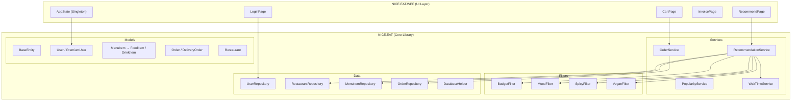

# NICE.EAT — OOP Presentation Walkthrough

> **System**: A restaurant recommendation app with cart-based ordering, built in C# (.NET) with WPF.
> **Architecture**: 2-project solution — `NICE.EAT` (core library) + `NICE.EAT.WPF` (UI layer).

---

## 1. Architecture Overview



---

## 2. End-to-End Flow

### STEP 1 — User Login

| Aspect | Detail |
|--------|--------|
| **Page** | [LoginPage.xaml.cs](file:///d:/Carlos/kuliah/OOP/NICE.EAT.WPF/Views/LoginPage.xaml.cs) |
| **User action** | Types username → clicks "Sign In" |
| **Method called** | [BtnSignIn_Click()](file:///d:/Carlos/kuliah/OOP/NICE.EAT.WPF/Views/LoginPage.xaml.cs#45-69) |
| **Data passed** | `string username` |
| **Internal flow** | `UserRepository.GetByUsername(username)` → SQL query on `users` table → [MapUser()](file:///d:/Carlos/kuliah/OOP/NICE.EAT/Data/UserRepository.cs#68-96) factory checks `user_type` column → returns [User](file:///d:/Carlos/kuliah/OOP/NICE.EAT/Models/User.cs#10-41) or [PremiumUser](file:///d:/Carlos/kuliah/OOP/NICE.EAT/Models/PremiumUser.cs#8-40) → stored in `AppState.Instance.CurrentUser` |

**Key detail**: The [MapUser()](file:///d:/Carlos/kuliah/OOP/NICE.EAT/Data/UserRepository.cs#68-96) factory inside [UserRepository](file:///d:/Carlos/kuliah/OOP/NICE.EAT/Data/UserRepository.cs#10-97) reads the `user_type` discriminator column. If it's `"Premium"`, it creates a [PremiumUser](file:///d:/Carlos/kuliah/OOP/NICE.EAT/Models/PremiumUser.cs#8-40) with [LoyaltyPoints](file:///d:/Carlos/kuliah/OOP/NICE.EAT/Models/PremiumUser.cs#34-39) and `DiscountRate`. Otherwise it creates a basic [User](file:///d:/Carlos/kuliah/OOP/NICE.EAT/Models/User.cs#10-41). This is **inheritance mapping** — one DB table, two different class types at runtime.

**Registration alternative**: [BtnRegister_Click()](file:///d:/Carlos/kuliah/OOP/NICE.EAT.WPF/Views/LoginPage.xaml.cs#70-93) → calls `UserRepository.CreateUser()` or [CreatePremiumUser()](file:///d:/Carlos/kuliah/OOP/NICE.EAT/Data/UserRepository.cs#46-67) depending on the checkbox → inserts into DB → sets `AppState.CurrentUser`.

---

### STEP 2 — Getting Recommendations

| Aspect | Detail |
|--------|--------|
| **Page** | [RecommendPage.xaml.cs](file:///d:/Carlos/kuliah/OOP/NICE.EAT.WPF/Views/RecommendPage.xaml.cs) |
| **User action** | Sets budget, spicy level, mood, vegan toggle → clicks "Search" |
| **Method called** | [BtnSearch_Click()](file:///d:/Carlos/kuliah/OOP/NICE.EAT.WPF/Views/RecommendPage.xaml.cs#59-110) |
| **Data passed** | `decimal budget`, `int spicyLevel`, `string mood`, `bool veganOnly` |

**Internal flow (this is the core of the system):**

```
1. _svc.ClearFilters()                         // reset from previous search
2. _svc.AddFilter(new BudgetFilter(budget))     // always added
3. _svc.AddFilter(new SpicyFilter(spicyLevel))  // always added
4. _svc.AddFilter(new MoodFilter(mood))          // always added
5. if (veganOnly) _svc.AddFilter(new VeganFilter())  // conditional

6. List<Restaurant> results = _svc.GetRecommendations()
```

Inside `RecommendationService.GetRecommendations()`:

```
Step A: var restaurants = _restaurantRepo.GetAll()
        → SQL: SELECT * FROM restaurants ORDER BY name
        → Returns List<Restaurant>

Step B: foreach (IFilterStrategy filter in _filters)
            restaurants = filter.Filter(restaurants)
        → Each filter shrinks the list (POLYMORPHISM — same .Filter() call, different behavior)

Step C: foreach restaurant → load r.Menu = _menuRepo.GetByRestaurant(r.Id)
        → COMPOSITION: Restaurant HAS-MANY MenuItem
        → MenuItemRepository.MapMenuItem() factory creates FoodItem or DrinkItem

Step D: foreach restaurant → r.WaitTimeMinutes = _waitService.Simulate(r.Id)
        → Random.Shared.Next(5, 46) — simulated wait time

Step E: return restaurants.OrderByDescending(r => r.Rating).ToList()
        → Final ranked list
```

Results are then mapped to [RestaurantViewModel](file:///d:/Carlos/kuliah/OOP/NICE.EAT.WPF/Views/RecommendPage.xaml.cs#24-35) objects for display.

---

### STEP 3 — Adding to Cart

| Aspect | Detail |
|--------|--------|
| **Page** | [RecommendPage.xaml.cs](file:///d:/Carlos/kuliah/OOP/NICE.EAT.WPF/Views/RecommendPage.xaml.cs) |
| **User action** | Clicks "Add" button next to a menu item |
| **Method called** | [BtnAddToCart_Click()](file:///d:/Carlos/kuliah/OOP/NICE.EAT.WPF/Views/RecommendPage.xaml.cs#111-123) → `AppState.Instance.AddToCart(...)` |
| **Data passed** | `restaurantId, restaurantName, menuItemId, menuItemName, price` |

**Internal flow in `AppState.AddToCart()`:**
- Searches [Cart](file:///d:/Carlos/kuliah/OOP/NICE.EAT.WPF/Views/CartPage.xaml.cs#44-51) list for existing [CartItem](file:///d:/Carlos/kuliah/OOP/NICE.EAT.WPF/ViewModels/CartItem.cs#9-22) with same `MenuItemId`
- If found → increments `Quantity`
- If not found → creates new [CartItem](file:///d:/Carlos/kuliah/OOP/NICE.EAT.WPF/ViewModels/CartItem.cs#9-22) and adds to [Cart](file:///d:/Carlos/kuliah/OOP/NICE.EAT.WPF/Views/CartPage.xaml.cs#44-51)
- This is a **Singleton pattern** — `AppState.Instance` is shared across all pages

---

### STEP 4 — Checkout

| Aspect | Detail |
|--------|--------|
| **Page** | [CartPage.xaml.cs](file:///d:/Carlos/kuliah/OOP/NICE.EAT.WPF/Views/CartPage.xaml.cs) |
| **User action** | Reviews cart, toggles delivery, clicks "Checkout" |
| **Method called** | [BtnCheckout_Click()](file:///d:/Carlos/kuliah/OOP/NICE.EAT.WPF/Views/CartPage.xaml.cs#157-215) |

**Internal flow:**

```
1. Validate: if delivery mode, delivery address must exist

2. For each CartItem × Quantity:
      OrderService.PlaceOrder(user, restaurantId, menuItemId, itemPrice, ...)
      
   Inside PlaceOrder():
      a) decimal finalPrice = user.CalculateOrderPrice(itemPrice)
         → POLYMORPHISM: User returns full price, PremiumUser applies discount
      
      b) if (user is PremiumUser premium)
            premium.AddLoyaltyPoints((int)(finalPrice / 1000))
      
      c) OrderRepository.AddOrder(...) → SQL INSERT → returns orderId

3. Build InvoiceData object with all cart info + computed discount

4. AppState.ClearCart()

5. Navigate to InvoicePage with InvoiceData
```

**Price calculation with polymorphism:**
```
User.CalculateOrderPrice(50000)     → returns 50000 (full price)
PremiumUser.CalculateOrderPrice(50000) → returns 50000 × (1 - 0.10) = 45000
```

---

## 3. Core Logic: RecommendationService

### 3a. Filtering System (IFilterStrategy — Strategy Pattern)

The [IFilterStrategy](file:///d:/Carlos/kuliah/OOP/NICE.EAT/Interfaces/IFilterStrategy.cs#10-20) interface defines a contract:

```csharp
public interface IFilterStrategy
{
    string FilterName { get; }
    List<Restaurant> Filter(List<Restaurant> restaurants);
}
```

Four implementations, each with different logic:

| Filter | Logic | Example |
|--------|-------|---------|
| [BudgetFilter](file:///d:/Carlos/kuliah/OOP/NICE.EAT/Services/Filters/BudgetFilter.cs#15-19) | `r.AveragePrice <= _maxBudget` | Budget 30000 → removes expensive restaurants |
| [SpicyFilter](file:///d:/Carlos/kuliah/OOP/NICE.EAT/Services/Filters/SpicyFilter.cs#15-19) | `r.SpicyLevel <= _maxSpicyLevel` | Max spicy 2 → removes level 3-5 restaurants |
| [MoodFilter](file:///d:/Carlos/kuliah/OOP/NICE.EAT/Services/Filters/MoodFilter.cs#10-34) | Matches mood tags via [MoodMapper](file:///d:/Carlos/kuliah/OOP/NICE.EAT/Utilities/MoodMapper.cs#7-36) | "sad" → tags ["sad","happy"] → matches restaurants with those tags |
| [VeganFilter](file:///d:/Carlos/kuliah/OOP/NICE.EAT/Services/Filters/VeganFilter.cs#9-19) | `r.IsVegan == true` | Only vegan restaurants |

**How they're used (the Strategy Pattern in action):**

```csharp
// In RecommendationService.GetRecommendations():
foreach (IFilterStrategy filter in _filters)
{
    restaurants = filter.Filter(restaurants);  // ← same method call, different behavior
}
```

> **Why this matters for your presentation**: The code doesn't care *which* filter it is. It just calls `.Filter()` on each one. That's **polymorphism through interfaces**. You can add a 5th filter later without changing [RecommendationService](file:///d:/Carlos/kuliah/OOP/NICE.EAT/Services/RecommendationService.cs#12-96) at all.

### 3b. Scoring System (IRecommendable)

```csharp
public interface IRecommendable
{
    string GetDisplayInfo();
    double GetRecommendationScore(decimal budget, int spicyPreference);
}
```

Two classes implement this: [Restaurant](file:///d:/Carlos/kuliah/OOP/NICE.EAT/Models/Restaurant.cs#11-59) and [FoodItem](file:///d:/Carlos/kuliah/OOP/NICE.EAT/Models/FoodItem.cs#10-42).

**Restaurant scoring:**

```csharp
double score = (double)Rating * 15;              // rating ×15 (max 75)
if (AveragePrice <= budget) score += 15;          // within budget: +15
if (Math.Abs(SpicyLevel - spicyPreference) <= 1) score += 10;  // spicy match: +10
return Math.Min(score, 100);
```

**FoodItem scoring:**

```csharp
double score = 50;                               // base 50
if (Price <= budget) score += 30;                 // within budget: +30
if (Math.Abs(SpicyLevel - spicyPreference) <= 1) score += 20;  // spicy match: +20
if (IsVegan) score += 5;                          // vegan bonus: +5
return Math.Min(score, 100);
```

> Same interface method, **different scoring algorithms**. That's polymorphism.

---

## 4. OOP Concepts in This Codebase

### 4a. Encapsulation

**What it is**: Hiding internal data behind controlled access (properties/methods). Outside code can't mess with internals directly.

**Where it appears:**

| Class | How |
|-------|-----|
| [AppState](file:///d:/Carlos/kuliah/OOP/NICE.EAT.WPF/ViewModels/AppState.cs#8-61) | [Cart](file:///d:/Carlos/kuliah/OOP/NICE.EAT.WPF/Views/CartPage.xaml.cs#44-51) has `private set` — only [AppState](file:///d:/Carlos/kuliah/OOP/NICE.EAT.WPF/ViewModels/AppState.cs#8-61) methods can modify the cart list. Other pages call [AddToCart()](file:///d:/Carlos/kuliah/OOP/NICE.EAT.WPF/ViewModels/AppState.cs#27-51), [RemoveFromCart()](file:///d:/Carlos/kuliah/OOP/NICE.EAT.WPF/ViewModels/AppState.cs#52-53), [ClearCart()](file:///d:/Carlos/kuliah/OOP/NICE.EAT.WPF/ViewModels/AppState.cs#54-60) instead of directly editing the list. |
| [BaseService](file:///d:/Carlos/kuliah/OOP/NICE.EAT/Services/BaseService.cs#7-34) | [Log()](file:///d:/Carlos/kuliah/OOP/NICE.EAT/Services/BaseService.cs#26-33) is `protected` — only subclasses can call it. Outside code can't log. |
| [CartItem](file:///d:/Carlos/kuliah/OOP/NICE.EAT.WPF/ViewModels/CartItem.cs#9-22) | `Subtotal` is a computed property (`UnitPrice * Quantity`) — no setter, can't be set to a wrong value. |
| [DatabaseHelper](file:///d:/Carlos/kuliah/OOP/NICE.EAT/Data/DatabaseHelper.cs#13-28) | `_connectionString` is `private static readonly` — nobody outside can read or change the DB connection string. |

**Why**: Prevents bugs from unexpected data changes. Forces all cart modifications through [AppState](file:///d:/Carlos/kuliah/OOP/NICE.EAT.WPF/ViewModels/AppState.cs#8-61) methods that maintain consistency.

---

### 4b. Inheritance

**What it is**: A child class reuses and extends the parent class's fields and behavior.

**Where it appears — 3 inheritance chains:**

**Chain 1: BaseEntity hierarchy (3 levels)**
```
BaseEntity (abstract)
├── User
│   └── PremiumUser          (2-level)
├── MenuItem (abstract)
│   ├── FoodItem              (3-level)
│   └── DrinkItem             (3-level)
├── Restaurant
└── Order
    └── DeliveryOrder         (2-level)
```

**Chain 2: BaseService hierarchy**
```
BaseService (abstract)
├── RecommendationService
├── OrderService
├── PopularityService
└── WaitTimeService
```

**What each level adds:**

| Parent → Child | What's inherited | What's added/changed |
|---------------|------------------|---------------------|
| [BaseEntity](file:///d:/Carlos/kuliah/OOP/NICE.EAT/Models/BaseEntity.cs#7-26) → [User](file:///d:/Carlos/kuliah/OOP/NICE.EAT/Models/User.cs#10-41) | [Id](file:///d:/Carlos/kuliah/OOP/NICE.EAT/Data/RestaurantRepository.cs#29-45), `CreatedAt`, [ToString()](file:///d:/Carlos/kuliah/OOP/NICE.EAT.WPF/Views/CartPage.xaml.cs#27-28) | [Username](file:///d:/Carlos/kuliah/OOP/NICE.EAT/Data/UserRepository.cs#12-28), `Email`, [OrderHistory](file:///d:/Carlos/kuliah/OOP/NICE.EAT/Data/OrderRepository.cs#36-66), [CalculateOrderPrice()](file:///d:/Carlos/kuliah/OOP/NICE.EAT/Models/PremiumUser.cs#19-28) |
| [User](file:///d:/Carlos/kuliah/OOP/NICE.EAT/Models/User.cs#10-41) → [PremiumUser](file:///d:/Carlos/kuliah/OOP/NICE.EAT/Models/PremiumUser.cs#8-40) | Everything from User | [LoyaltyPoints](file:///d:/Carlos/kuliah/OOP/NICE.EAT/Models/PremiumUser.cs#34-39), `DiscountRate`, overrides [CalculateOrderPrice()](file:///d:/Carlos/kuliah/OOP/NICE.EAT/Models/PremiumUser.cs#19-28) for discount |
| [MenuItem](file:///d:/Carlos/kuliah/OOP/NICE.EAT/Models/MenuItem.cs#9-37) → [FoodItem](file:///d:/Carlos/kuliah/OOP/NICE.EAT/Models/FoodItem.cs#10-42) | All MenuItem fields | `PortionSize`, implements [IRecommendable](file:///d:/Carlos/kuliah/OOP/NICE.EAT/Interfaces/IRecommendable.cs#9-20) |
| [MenuItem](file:///d:/Carlos/kuliah/OOP/NICE.EAT/Models/MenuItem.cs#9-37) → [DrinkItem](file:///d:/Carlos/kuliah/OOP/NICE.EAT/Models/DrinkItem.cs#7-26) | All MenuItem fields | `IsCold`, `VolumeInMl` |
| [Order](file:///d:/Carlos/kuliah/OOP/NICE.EAT/Models/Order.cs#10-50) → [DeliveryOrder](file:///d:/Carlos/kuliah/OOP/NICE.EAT/Models/DeliveryOrder.cs#8-32) | All Order fields | `DeliveryAddress`, `DeliveryFee`, overrides [GetTotalPrice()](file:///d:/Carlos/kuliah/OOP/NICE.EAT/Models/DeliveryOrder.cs#17-26) to add fee |
| [BaseService](file:///d:/Carlos/kuliah/OOP/NICE.EAT/Services/BaseService.cs#7-34) → all services | `ServiceName`, [Log()](file:///d:/Carlos/kuliah/OOP/NICE.EAT/Services/BaseService.cs#26-33), [IsReady()](file:///d:/Carlos/kuliah/OOP/NICE.EAT/Services/BaseService.cs#17-25) | Each service adds its specific logic |

**Why**: Avoids code duplication. [Id](file:///d:/Carlos/kuliah/OOP/NICE.EAT/Data/RestaurantRepository.cs#29-45) and `CreatedAt` are defined once in [BaseEntity](file:///d:/Carlos/kuliah/OOP/NICE.EAT/Models/BaseEntity.cs#7-26), used by all 9 model classes.

---

### 4c. Polymorphism

**What it is**: Same method call, different behavior depending on the actual object type at runtime.

**Where it appears — 4 clear examples:**

**Example 1: `User.CalculateOrderPrice()` (virtual/override)**
```csharp
// In OrderService.PlaceOrder():
decimal finalPrice = user.CalculateOrderPrice(itemPrice);

// If user is User      → returns itemPrice (full price)
// If user is PremiumUser → returns itemPrice × (1 - DiscountRate)
```
The variable `user` is typed as [User](file:///d:/Carlos/kuliah/OOP/NICE.EAT/Models/User.cs#10-41), but at runtime it could be a [PremiumUser](file:///d:/Carlos/kuliah/OOP/NICE.EAT/Models/PremiumUser.cs#8-40). The correct override runs automatically.

**Example 2: `IFilterStrategy.Filter()` (interface polymorphism)**
```csharp
foreach (IFilterStrategy filter in _filters)
{
    restaurants = filter.Filter(restaurants);
    // BudgetFilter.Filter() → checks price
    // MoodFilter.Filter()   → checks mood tags
    // SpicyFilter.Filter()  → checks spicy level
    // VeganFilter.Filter()  → checks vegan flag
}
```

**Example 3: `IRecommendable.GetRecommendationScore()` (interface polymorphism)**
```csharp
IRecommendable recommendable = restaurant;  // or FoodItem
recommendable.GetRecommendationScore(budget, spicyPref);
// Restaurant → rating-based scoring
// FoodItem   → price-based scoring
```

**Example 4: `MenuItem.GetDescription()` (abstract/override)**
```csharp
// FoodItem.GetDescription() → "[Indonesian] Nasi Goreng (Regular) | Spicy: 3/5 — Rp 25,000"
// DrinkItem.GetDescription() → "[Drink] Es Teh (300ml, 🧊 Cold) — Rp 8,000"
```

**Example 5: `Order.GetTotalPrice()` (virtual/override)**
```csharp
// Order.GetTotalPrice()          → returns item price
// DeliveryOrder.GetTotalPrice()  → returns item price + DeliveryFee
```

**Why**: Lets you write code that works with the parent type but automatically uses the child's logic. [OrderService](file:///d:/Carlos/kuliah/OOP/NICE.EAT/Services/OrderService.cs#13-63) doesn't need `if/else` to check user type — polymorphism handles it.

---

### 4d. Interface Usage

**What it is**: A contract that says "any class implementing me must have these methods." No implementation, just method signatures.

**Where it appears — 2 interfaces:**

**[IRecommendable](file:///d:/Carlos/kuliah/OOP/NICE.EAT/Interfaces/IRecommendable.cs#9-20)** — shared by [Restaurant](file:///d:/Carlos/kuliah/OOP/NICE.EAT/Models/Restaurant.cs#11-59) and [FoodItem](file:///d:/Carlos/kuliah/OOP/NICE.EAT/Models/FoodItem.cs#10-42)
```csharp
public interface IRecommendable
{
    string GetDisplayInfo();
    double GetRecommendationScore(decimal budget, int spicyPreference);
}
```
- [Restaurant](file:///d:/Carlos/kuliah/OOP/NICE.EAT/Models/Restaurant.cs#11-59) and [FoodItem](file:///d:/Carlos/kuliah/OOP/NICE.EAT/Models/FoodItem.cs#10-42) are completely different classes (different parent chains)
- But both can be "recommended" → both implement [IRecommendable](file:///d:/Carlos/kuliah/OOP/NICE.EAT/Interfaces/IRecommendable.cs#9-20)
- `RecommendationService.PrintRecommendationScores()` treats them identically through the interface

**[IFilterStrategy](file:///d:/Carlos/kuliah/OOP/NICE.EAT/Interfaces/IFilterStrategy.cs#10-20)** — implemented by 4 filter classes
```csharp
public interface IFilterStrategy
{
    string FilterName { get; }
    List<Restaurant> Filter(List<Restaurant> restaurants);
}
```
- This is the **Strategy design pattern**
- [RecommendationService](file:///d:/Carlos/kuliah/OOP/NICE.EAT/Services/RecommendationService.cs#12-96) holds a `List<IFilterStrategy>` — it doesn't know or care about the concrete types
- New filters can be added by simply creating a new class that implements [IFilterStrategy](file:///d:/Carlos/kuliah/OOP/NICE.EAT/Interfaces/IFilterStrategy.cs#10-20)

**Why**: Interfaces enable **loose coupling**. [RecommendationService](file:///d:/Carlos/kuliah/OOP/NICE.EAT/Services/RecommendationService.cs#12-96) depends on [IFilterStrategy](file:///d:/Carlos/kuliah/OOP/NICE.EAT/Interfaces/IFilterStrategy.cs#10-20), not on [BudgetFilter](file:///d:/Carlos/kuliah/OOP/NICE.EAT/Services/Filters/BudgetFilter.cs#15-19) directly. This makes the system flexible and extensible.

---

## 5. Key Code Explanations

### Snippet 1: The Strategy Pattern in Action

```csharp
// RecommendationService.cs — GetRecommendations()
foreach (IFilterStrategy filter in _filters)
{
    int before = restaurants.Count;
    restaurants = filter.Filter(restaurants);
    Log($"{filter.FilterName}: {before} → {restaurants.Count} restaurants");
}
```

**Explanation**: This loop is the heart of the recommendation engine. It takes the full restaurant list and passes it through a *pipeline* of filters. Each filter shrinks the list according to its own rule. The beauty is that [RecommendationService](file:///d:/Carlos/kuliah/OOP/NICE.EAT/Services/RecommendationService.cs#12-96) doesn't know what filters exist — it just calls `.Filter()` on whatever has been added. This is the **Strategy pattern**: swap out filter algorithms at runtime without changing the service code.

---

### Snippet 2: Factory-Style Inheritance Mapping

```csharp
// MenuItemRepository.cs — MapMenuItem()
private static MenuItem MapMenuItem(SqliteDataReader r)
{
    string itemType = r.GetString("item_type");

    if (itemType == "Drink")
        return new DrinkItem { /* ... */ };

    return new FoodItem { /* ... */ };
}
```

**Explanation**: The database has one `menu_items` table with an `item_type` column (a "discriminator"). When reading data, this method decides which *subclass* to create based on that column value. The return type is [MenuItem](file:///d:/Carlos/kuliah/OOP/NICE.EAT/Models/MenuItem.cs#9-37) (the parent), but the actual object is [FoodItem](file:///d:/Carlos/kuliah/OOP/NICE.EAT/Models/FoodItem.cs#10-42) or [DrinkItem](file:///d:/Carlos/kuliah/OOP/NICE.EAT/Models/DrinkItem.cs#7-26). This is how **inheritance** bridges the gap between a flat database table and an object-oriented class hierarchy.

The same pattern is used in `UserRepository.MapUser()` (creates [User](file:///d:/Carlos/kuliah/OOP/NICE.EAT/Models/User.cs#10-41) or [PremiumUser](file:///d:/Carlos/kuliah/OOP/NICE.EAT/Models/PremiumUser.cs#8-40)) and `OrderRepository.MapOrder()` (creates [Order](file:///d:/Carlos/kuliah/OOP/NICE.EAT/Models/Order.cs#10-50) or [DeliveryOrder](file:///d:/Carlos/kuliah/OOP/NICE.EAT/Models/DeliveryOrder.cs#8-32)).

---

### Snippet 3: Polymorphic Price Calculation

```csharp
// OrderService.cs — PlaceOrder()
decimal finalPrice = user.CalculateOrderPrice(itemPrice);

if (user is PremiumUser premium)
{
    int points = (int)(finalPrice / 1000);
    premium.AddLoyaltyPoints(points);
}
```

**Explanation**: The first line calls [CalculateOrderPrice()](file:///d:/Carlos/kuliah/OOP/NICE.EAT/Models/PremiumUser.cs#19-28) on a [User](file:///d:/Carlos/kuliah/OOP/NICE.EAT/Models/User.cs#10-41) reference. If the actual runtime object is a [PremiumUser](file:///d:/Carlos/kuliah/OOP/NICE.EAT/Models/PremiumUser.cs#8-40), C# automatically calls the *overridden* version that applies a discount. The code doesn't need an `if (user is PremiumUser)` check for the price — **polymorphism does it automatically**.

The `if` block below is a *type check* — it's only used for the loyalty points feature which only [PremiumUser](file:///d:/Carlos/kuliah/OOP/NICE.EAT/Models/PremiumUser.cs#8-40) has. This shows the difference: use polymorphism when both types share behavior (price calculation), use type checking when only one type has the feature (loyalty points).

---

### Snippet 4: Composition — Restaurant owns Menu Items

```csharp
// Restaurant.cs
public List<MenuItem> Menu { get; set; } = new();

// RecommendationService.cs — loading the menu
foreach (var r in restaurants)
{
    r.Menu = _menuRepo.GetByRestaurant(r.Id);
}
```

**Explanation**: A [Restaurant](file:///d:/Carlos/kuliah/OOP/NICE.EAT/Models/Restaurant.cs#11-59) object *has many* [MenuItem](file:///d:/Carlos/kuliah/OOP/NICE.EAT/Models/MenuItem.cs#9-37) objects — this is **composition**. The restaurant "owns" its menu. When we load recommendations, we fetch each restaurant's menu items from the database and attach them to the `Restaurant.Menu` property. If the restaurant is deleted, its menu items belong nowhere. This "has-a" relationship is different from inheritance ("is-a").

---

### Snippet 5: Singleton AppState

```csharp
// AppState.cs
private static AppState? _instance;
public static AppState Instance => _instance ??= new AppState();
```

**Explanation**: The `??=` operator means "if `_instance` is null, create a new one and assign it." This guarantees there's only ever **one** [AppState](file:///d:/Carlos/kuliah/OOP/NICE.EAT.WPF/ViewModels/AppState.cs#8-61) object in the entire application. Every page ([LoginPage](file:///d:/Carlos/kuliah/OOP/NICE.EAT.WPF/Views/LoginPage.xaml.cs#14-19), [RecommendPage](file:///d:/Carlos/kuliah/OOP/NICE.EAT.WPF/Views/RecommendPage.xaml.cs#36-145), [CartPage](file:///d:/Carlos/kuliah/OOP/NICE.EAT.WPF/Views/CartPage.xaml.cs#44-51)) accesses the same instance. That's how the logged-in user and shopping cart persist as you navigate between pages.

---

## 6. Lecturer-Style Questions & Answers

### Q1: Why is [BaseEntity](file:///d:/Carlos/kuliah/OOP/NICE.EAT/Models/BaseEntity.cs#7-26) abstract? What would happen if it weren't?

**A**: [BaseEntity](file:///d:/Carlos/kuliah/OOP/NICE.EAT/Models/BaseEntity.cs#7-26) is abstract because you should never create a "plain" entity — it only makes sense as a [User](file:///d:/Carlos/kuliah/OOP/NICE.EAT/Models/User.cs#10-41), [Restaurant](file:///d:/Carlos/kuliah/OOP/NICE.EAT/Models/Restaurant.cs#11-59), [Order](file:///d:/Carlos/kuliah/OOP/NICE.EAT/Models/Order.cs#10-50), etc. Making it abstract **forces** subclasses to exist. If it weren't abstract, someone could write `new BaseEntity()` which is meaningless in our domain.

---

### Q2: Explain the inheritance chain for [FoodItem](file:///d:/Carlos/kuliah/OOP/NICE.EAT/Models/FoodItem.cs#10-42). How many levels is it?

**A**: [FoodItem](file:///d:/Carlos/kuliah/OOP/NICE.EAT/Models/FoodItem.cs#10-42) has **3 levels**: [BaseEntity](file:///d:/Carlos/kuliah/OOP/NICE.EAT/Models/BaseEntity.cs#7-26) → [MenuItem](file:///d:/Carlos/kuliah/OOP/NICE.EAT/Models/MenuItem.cs#9-37) → [FoodItem](file:///d:/Carlos/kuliah/OOP/NICE.EAT/Models/FoodItem.cs#10-42). It inherits [Id](file:///d:/Carlos/kuliah/OOP/NICE.EAT/Data/RestaurantRepository.cs#29-45) and `CreatedAt` from [BaseEntity](file:///d:/Carlos/kuliah/OOP/NICE.EAT/Models/BaseEntity.cs#7-26), then `Name`, [Price](file:///d:/Carlos/kuliah/OOP/NICE.EAT/Models/DeliveryOrder.cs#17-26), `SpicyLevel`, `Category` from [MenuItem](file:///d:/Carlos/kuliah/OOP/NICE.EAT/Models/MenuItem.cs#9-37), and adds its own `PortionSize`. It also overrides [GetItemType()](file:///d:/Carlos/kuliah/OOP/NICE.EAT/Models/DrinkItem.cs#14-15) to return `"Food"` and [GetDescription()](file:///d:/Carlos/kuliah/OOP/NICE.EAT/Models/FoodItem.cs#18-24) to format food-specific output.

---

### Q3: How does the system know whether to create a [User](file:///d:/Carlos/kuliah/OOP/NICE.EAT/Models/User.cs#10-41) or [PremiumUser](file:///d:/Carlos/kuliah/OOP/NICE.EAT/Models/PremiumUser.cs#8-40) from the database?

**A**: `UserRepository.MapUser()` reads the `user_type` column. If it's `"Premium"`, it creates a [PremiumUser](file:///d:/Carlos/kuliah/OOP/NICE.EAT/Models/PremiumUser.cs#8-40) with [LoyaltyPoints](file:///d:/Carlos/kuliah/OOP/NICE.EAT/Models/PremiumUser.cs#34-39) and `DiscountRate`. Otherwise, it creates a basic [User](file:///d:/Carlos/kuliah/OOP/NICE.EAT/Models/User.cs#10-41). The return type is [User](file:///d:/Carlos/kuliah/OOP/NICE.EAT/Models/User.cs#10-41) (the parent), so calling code doesn't need to know which type it got — that's polymorphism.

---

### Q4: What design pattern does [IFilterStrategy](file:///d:/Carlos/kuliah/OOP/NICE.EAT/Interfaces/IFilterStrategy.cs#10-20) represent? Why not just use `if/else` in [RecommendationService](file:///d:/Carlos/kuliah/OOP/NICE.EAT/Services/RecommendationService.cs#12-96)?

**A**: It's the **Strategy pattern**. Using `if/else` would mean modifying [RecommendationService](file:///d:/Carlos/kuliah/OOP/NICE.EAT/Services/RecommendationService.cs#12-96) every time we add a new filter — violating the **Open/Closed Principle** (open for extension, closed for modification). With [IFilterStrategy](file:///d:/Carlos/kuliah/OOP/NICE.EAT/Interfaces/IFilterStrategy.cs#10-20), we just create a new class implementing the interface and call [AddFilter()](file:///d:/Carlos/kuliah/OOP/NICE.EAT/Services/RecommendationService.cs#32-38). [RecommendationService](file:///d:/Carlos/kuliah/OOP/NICE.EAT/Services/RecommendationService.cs#12-96) code stays unchanged.

---

### Q5: Show where polymorphism occurs in the ordering process.

**A**: In `OrderService.PlaceOrder()`: `user.CalculateOrderPrice(itemPrice)`. The variable `user` is typed as [User](file:///d:/Carlos/kuliah/OOP/NICE.EAT/Models/User.cs#10-41), but at runtime it could be a [PremiumUser](file:///d:/Carlos/kuliah/OOP/NICE.EAT/Models/PremiumUser.cs#8-40). If it's a [PremiumUser](file:///d:/Carlos/kuliah/OOP/NICE.EAT/Models/PremiumUser.cs#8-40), the overridden method applies the discount automatically. No conditional logic needed for price calculation.

---

### Q6: What's the difference between `abstract` and `virtual` methods in this codebase?

**A**: `abstract` (e.g., `MenuItem.GetItemType()`) has **no body** — subclasses *must* override it. `virtual` (e.g., `User.CalculateOrderPrice()`) has a **default body** — subclasses *can* override it but don't have to. `User.CalculateOrderPrice()` defaults to returning full price; [PremiumUser](file:///d:/Carlos/kuliah/OOP/NICE.EAT/Models/PremiumUser.cs#8-40) overrides it to apply a discount.

---

### Q7: Where is composition used in the [Restaurant](file:///d:/Carlos/kuliah/OOP/NICE.EAT/Models/Restaurant.cs#11-59) class?

**A**: [Restaurant](file:///d:/Carlos/kuliah/OOP/NICE.EAT/Models/Restaurant.cs#11-59) has a `List<MenuItem> Menu` property — this is composition ("has-many"). A restaurant *has* menu items. The menu items don't exist independently; they belong to a restaurant. This is different from inheritance — a restaurant is not a type of menu item, it *contains* menu items.

---

### Q8: Why does [FoodItem](file:///d:/Carlos/kuliah/OOP/NICE.EAT/Models/FoodItem.cs#10-42) implement [IRecommendable](file:///d:/Carlos/kuliah/OOP/NICE.EAT/Interfaces/IRecommendable.cs#9-20) but [DrinkItem](file:///d:/Carlos/kuliah/OOP/NICE.EAT/Models/DrinkItem.cs#7-26) doesn't?

**A**: Design choice. [FoodItem](file:///d:/Carlos/kuliah/OOP/NICE.EAT/Models/FoodItem.cs#10-42) is the primary food recommendation target and has a scoring algorithm. [DrinkItem](file:///d:/Carlos/kuliah/OOP/NICE.EAT/Models/DrinkItem.cs#7-26) currently doesn't participate in the scoring system. But [DrinkItem](file:///d:/Carlos/kuliah/OOP/NICE.EAT/Models/DrinkItem.cs#7-26) *could* implement [IRecommendable](file:///d:/Carlos/kuliah/OOP/NICE.EAT/Interfaces/IRecommendable.cs#9-20) in the future without changing any existing code — that's the power of interfaces.

---

### Q9: How does [MoodFilter](file:///d:/Carlos/kuliah/OOP/NICE.EAT/Services/Filters/MoodFilter.cs#10-34) actually work? Trace the data flow for mood "sad".

**A**: User selects "sad" → [MoodFilter("sad")](file:///d:/Carlos/kuliah/OOP/NICE.EAT/Services/Filters/MoodFilter.cs#10-34) constructor → calls `MoodMapper.ResolveTags("sad")` → returns `["sad", "happy"]` → stored in `_moodTags`. When [Filter()](file:///d:/Carlos/kuliah/OOP/NICE.EAT/Services/Filters/VeganFilter.cs#13-18) runs: for each restaurant, it calls `r.GetMoodTagList()` which splits the `mood_tags` DB column by commas. If any restaurant tag matches `"sad"` or `"happy"`, the restaurant passes the filter.

---

### Q10: What is the role of [BaseService](file:///d:/Carlos/kuliah/OOP/NICE.EAT/Services/BaseService.cs#7-34) and why is it useful?

**A**: [BaseService](file:///d:/Carlos/kuliah/OOP/NICE.EAT/Services/BaseService.cs#7-34) is an abstract class that provides: (1) a `ServiceName` property, (2) a [Log()](file:///d:/Carlos/kuliah/OOP/NICE.EAT/Services/BaseService.cs#26-33) method for debug output, and (3) a virtual [IsReady()](file:///d:/Carlos/kuliah/OOP/NICE.EAT/Services/BaseService.cs#17-25) method. All four services extend it. Without [BaseService](file:///d:/Carlos/kuliah/OOP/NICE.EAT/Services/BaseService.cs#7-34), each service would duplicate the logging code. It's an example of **inheritance for code reuse**.

---

### Q11: Explain the Singleton pattern in [AppState](file:///d:/Carlos/kuliah/OOP/NICE.EAT.WPF/ViewModels/AppState.cs#8-61). Why is it needed here?

**A**: [AppState](file:///d:/Carlos/kuliah/OOP/NICE.EAT.WPF/ViewModels/AppState.cs#8-61) uses a static field `_instance` with lazy initialization (`??=`). It's needed because multiple pages (Login, Recommend, Cart) all need to access the same logged-in user and the same cart. Without Singleton, each page would have its own separate copy and cart items would be lost when navigating.

---

### Q12: How does `DeliveryOrder.GetTotalPrice()` demonstrate polymorphism?

**A**: `Order.GetTotalPrice()` returns just the item price. [DeliveryOrder](file:///d:/Carlos/kuliah/OOP/NICE.EAT/Models/DeliveryOrder.cs#8-32) *overrides* it: `return base.GetTotalPrice() + DeliveryFee`. It calls the parent's implementation first, then adds the delivery fee. If you have a `List<Order>` containing both types and call `.GetTotalPrice()` on each, delivery orders automatically include the fee — no `if/else` needed.

---

### Q13: Why are [GetItemType()](file:///d:/Carlos/kuliah/OOP/NICE.EAT/Models/DrinkItem.cs#14-15) and [GetDescription()](file:///d:/Carlos/kuliah/OOP/NICE.EAT/Models/FoodItem.cs#18-24) abstract in [MenuItem](file:///d:/Carlos/kuliah/OOP/NICE.EAT/Models/MenuItem.cs#9-37) but [MatchesBudget()](file:///d:/Carlos/kuliah/OOP/NICE.EAT/Models/DrinkItem.cs#23-25) is virtual?

**A**: [GetItemType()](file:///d:/Carlos/kuliah/OOP/NICE.EAT/Models/DrinkItem.cs#14-15) and [GetDescription()](file:///d:/Carlos/kuliah/OOP/NICE.EAT/Models/FoodItem.cs#18-24) are `abstract` because every menu item *must* define its own type and description — there's no sensible default. [MatchesBudget()](file:///d:/Carlos/kuliah/OOP/NICE.EAT/Models/DrinkItem.cs#23-25) is `virtual` because the default logic (`Price <= maxPrice`) works for both food and drinks. A subclass *can* override it if needed, but it doesn't have to.

---

### Q14: What would you change to add a new filter, say "RatingFilter" that only shows 4+ star restaurants?

**A**: Create `RatingFilter.cs` implementing [IFilterStrategy](file:///d:/Carlos/kuliah/OOP/NICE.EAT/Interfaces/IFilterStrategy.cs#10-20):
```csharp
public class RatingFilter : IFilterStrategy
{
    public string FilterName => "Rating Filter";
    public List<Restaurant> Filter(List<Restaurant> restaurants)
        => restaurants.Where(r => r.Rating >= 4.0m).ToList();
}
```
Then in the UI: `_svc.AddFilter(new RatingFilter())`. **Zero changes** to [RecommendationService](file:///d:/Carlos/kuliah/OOP/NICE.EAT/Services/RecommendationService.cs#12-96) or any existing filter.

---

### Q15: Explain the flow when a [PremiumUser](file:///d:/Carlos/kuliah/OOP/NICE.EAT/Models/PremiumUser.cs#8-40) with 10% discount orders a Rp 50,000 item with delivery.

**A**:
1. `OrderService.PlaceOrder()` calls `user.CalculateOrderPrice(50000)`
2. [PremiumUser](file:///d:/Carlos/kuliah/OOP/NICE.EAT/Models/PremiumUser.cs#8-40) override: `50000 × (1 - 0.10) = 45,000`
3. Loyalty points: `45000 / 1000 = 45` points awarded
4. `OrderRepository.AddOrder()` inserts with `order_type = "Delivery"`, `delivery_fee = 5000`
5. Invoice shows: subtotal 50,000 − discount 5,000 + delivery 5,000 = **total 50,000**

---

## 7. Presentation Script (1–2 minutes)

> **"Our project is NICE.EAT — a restaurant recommendation system built with C# and WPF.**
>
> **The architecture is split into two layers**: a core library for all business logic, and a WPF layer for the UI. This separation keeps our code clean and testable.
>
> **The flow works like this**: A user logs in — we check the database and create either a [User](file:///d:/Carlos/kuliah/OOP/NICE.EAT/Models/User.cs#10-41) or [PremiumUser](file:///d:/Carlos/kuliah/OOP/NICE.EAT/Models/PremiumUser.cs#8-40) object using a factory pattern in the repository. Then on the recommendation page, the user sets their preferences — budget, spicy level, mood, and vegan preference. Each preference becomes a **filter object** implementing the [IFilterStrategy](file:///d:/Carlos/kuliah/OOP/NICE.EAT/Interfaces/IFilterStrategy.cs#10-20) interface — this is the **Strategy pattern**. The [RecommendationService](file:///d:/Carlos/kuliah/OOP/NICE.EAT/Services/RecommendationService.cs#12-96) runs all filters through a loop without knowing which specific filter it's using — that's **polymorphism through interfaces**.
>
> **For inheritance**, we have a clean 3-level chain: [BaseEntity](file:///d:/Carlos/kuliah/OOP/NICE.EAT/Models/BaseEntity.cs#7-26) → [MenuItem](file:///d:/Carlos/kuliah/OOP/NICE.EAT/Models/MenuItem.cs#9-37) → [FoodItem](file:///d:/Carlos/kuliah/OOP/NICE.EAT/Models/FoodItem.cs#10-42)/[DrinkItem](file:///d:/Carlos/kuliah/OOP/NICE.EAT/Models/DrinkItem.cs#7-26). Every model class inherits [Id](file:///d:/Carlos/kuliah/OOP/NICE.EAT/Data/RestaurantRepository.cs#29-45) and `CreatedAt` from [BaseEntity](file:///d:/Carlos/kuliah/OOP/NICE.EAT/Models/BaseEntity.cs#7-26) so we don't repeat code.
>
> **Polymorphism shows up** in three places: the filter pipeline, the recommendation scoring where both [Restaurant](file:///d:/Carlos/kuliah/OOP/NICE.EAT/Models/Restaurant.cs#11-59) and [FoodItem](file:///d:/Carlos/kuliah/OOP/NICE.EAT/Models/FoodItem.cs#10-42) implement [IRecommendable](file:///d:/Carlos/kuliah/OOP/NICE.EAT/Interfaces/IRecommendable.cs#9-20) with different algorithms, and the pricing system where [PremiumUser](file:///d:/Carlos/kuliah/OOP/NICE.EAT/Models/PremiumUser.cs#8-40) overrides [CalculateOrderPrice()](file:///d:/Carlos/kuliah/OOP/NICE.EAT/Models/PremiumUser.cs#19-28) to apply a discount — the [OrderService](file:///d:/Carlos/kuliah/OOP/NICE.EAT/Services/OrderService.cs#13-63) just calls the method without needing to know the user type.
>
> **Encapsulation** is demonstrated in [AppState](file:///d:/Carlos/kuliah/OOP/NICE.EAT.WPF/ViewModels/AppState.cs#8-61) — the cart list has a private setter, so all modifications go through controlled methods like [AddToCart()](file:///d:/Carlos/kuliah/OOP/NICE.EAT.WPF/ViewModels/AppState.cs#27-51) and [ClearCart()](file:///d:/Carlos/kuliah/OOP/NICE.EAT.WPF/ViewModels/AppState.cs#54-60).
>
> **The key advantage of this design** is extensibility. To add a new filter, we just create a new class implementing [IFilterStrategy](file:///d:/Carlos/kuliah/OOP/NICE.EAT/Interfaces/IFilterStrategy.cs#10-20). To add a new user tier, we just extend [User](file:///d:/Carlos/kuliah/OOP/NICE.EAT/Models/User.cs#10-41). No existing code needs to change. That's the power of OOP."
